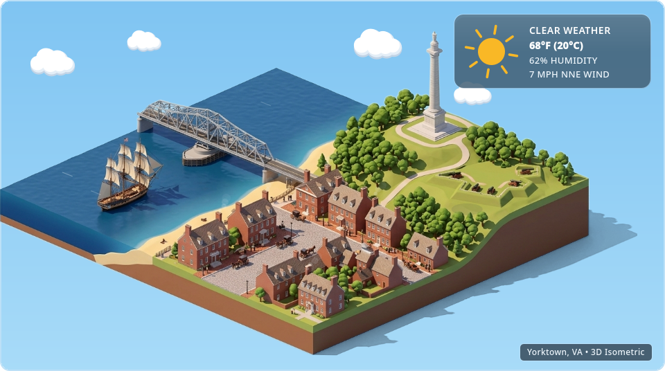
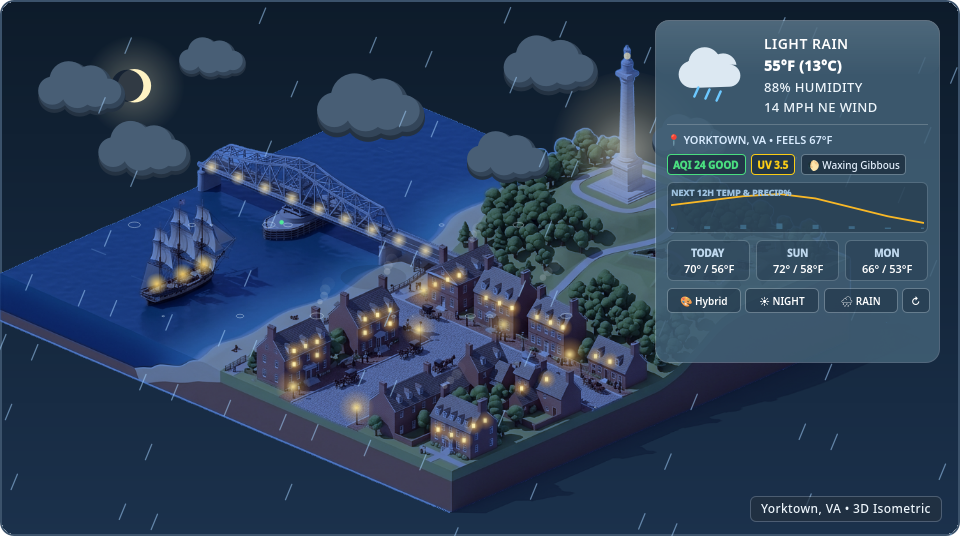
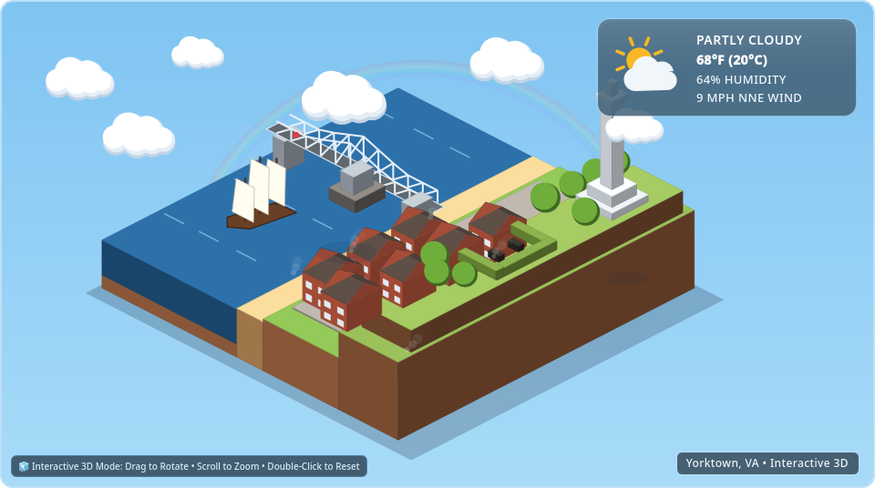

# Global 3D Isometric Weather Widget (`v0.0.1`)

A **Global 3D Isometric Real-Time & Generative Weather Widget** built for **KDE Plasma 6 (Bazzite / Linux Desktop)**, **Web / PWA**, and **Android Homescreen & Lockscreen (OnePlus 13 / Android 12+)**.

Inspired by tilt-shift isometric architectural dioramas, the widget combines **built-in Pre-Generated Generic 3D Isometric Dioramas**, **Historic Yorktown, VA**, and an **integrated Config Menu High-Res City Diorama Cutout Generator** that synthesizes custom Day, Sunset, and Starry Night cutouts for **any city on Earth** right from the settings menu.

---

## Visual Previews

| Sunny Daylight (Hybrid 3D Diorama) | Night Rain & Expanded HUD (AQI / UV / Moon / 12h Sparkline) | Interactive Procedural 3D Mode |
| :---: | :---: | :---: |
|  |  |  |

---

## Key Features

### 1. Built-In Pre-Generated Generic Dioramas + In-Menu Custom City Cutout Generator
Directly inside the **Configuration Menu** on both **KDE Plasma 6** and **Android**, you can choose from **4 Pre-Generated High-Resolution 3D Isometric Diorama Cutout Sets** (`1376×768` RGBA with Day, Sunset & Night variants) or generate a custom cutout for any city on Earth:
1. **`yorktown` — Historic Yorktown, VA (Default)**: Features the **George P. Coleman Memorial Bridge**, **18th-Century Tall Ship on the York River**, **Colonial Main Street / Custom House / Nelson House**, **Yorktown Victory Monument**, and **1781 Revolutionary War Siege Redoubts**.
2. **`coastal` — Pre-Generated Generic: Coastal Harbor & Lighthouse Town (Non-City-Specific)**: A scenic red-and-white striped lighthouse on a rocky headland, stone pier, sailboats, fishing boats, and harbor town.
3. **`modern` — Pre-Generated Generic: Modern Downtown Metropolis & Bridge (Non-City-Specific)**: Glass skyscrapers, red suspension bridge with miniature cars, waterfront park, and harbor ferry.
4. **`alpine` — Pre-Generated Generic: Alpine Mountain & Lake Village (Non-City-Specific)**: Snow-dusted alpine peaks, pine forest, wooden chalets, stone arch bridge, and emerald mountain lake.
5. **`custom_city` — Built-In Config Menu "Generate Custom High-Res Diorama Cutout for Any City"**:
   - Located directly inside the **KDE Configuration Window** (`ConfigAppearance.qml` & `ConfigLocation.qml`) and the **Android Configuration App** (`MainActivity.kt`)—no external CLI command or manual file copying required!
   - Enter any city or architectural prompt and click **`✨ Generate High-Res Cutout`**. The widget automatically queries Wikipedia GeoSearch for local landmarks, synthesizes a 3D isometric floating-island diorama, performs edge flood-fill background removal, and generates matching Day, Golden Hour Sunset, and Starry Night textures on-device.

### 2. Isometric Zoom & Horizontal Centering (Overlay Stays Fixed)
- **Zoom & Horizontal Offset (`➖` `➕` `◀` `🎯` `▶`)**:
  - **Rotation is intentionally disabled** so the isometric island always stays at its crisp architectural projection angle.
  - **Move Isometric Left / Center / Right (`◀` `🎯` `▶` or Horizontal Drag / Slider)**: Shift the entire 3D isometric diorama left or right as a whole (`-220 px` to `+220 px`) to frame or center it wherever you like **while the Weather HUD Overlay stays stationary in its configured position**.
  - **Zoom In / Out (`➖` `➕` / Scroll Wheel / Pinch)**: Smoothly scale the isometric diorama from `65%` to `240%`.

### 3. Extrapolated, High-Readability Android Widget HUD (Zero Island Overlap)
- On Android Homescreens (`widget_isometric_weather.xml` & `IsometricWeatherWidgetProvider.kt`), the weather overlay is rendered using **native high-DPI Android `RemoteViews` typography** rather than downsampled bitmap text:
  - **Top-Sky Split Banner (`top-sky`, Recommended Default)**: Docks a wide, extrapolated translucent glass header across the upper sky (`17sp+` bold temperature, condition, location, humidity, wind, AQI, UV, and Moon phase) while shifting the 3D isometric island slightly downward so **0% of the 3D town is covered**.
  - **Top-Right / Top-Left Corner Card (`top-right`, `top-left`)**: Classic corner card layout with configurable **Extrapolated Text Size (`100%`, `115% Recommended`, `130% Extra-Large`)**.

### 4. Spacious, Scroll-Safe Android Configuration Menu
- The Android Configuration App (`MainActivity.kt`) uses a **single full-screen vertical `ScrollView`** with `FOCUS_BEFORE_DESCENDANTS` and replaces hair-trigger `Spinner` dropdowns with **scroll-safe modal `AlertDialog` setting cards** that only open on a deliberate tap—eliminating accidental dropdown pops or keyboard focus thefts while scrolling.

### 5. Static Scenic Miniature Sprites & Calm Weather Physics
- **Static Scenic Miniature Sprites**: Stationed colonial Horse & Carriage on Historic Main Street, miniature cars on the Coleman Bridge / suspension bridges, and harbor sailboats (animated walking people removed for a clean, distraction-free architectural model aesthetic).
- **Calm, Natural-Speed Weather Particles**: Gentle rain and snow physics (`25%`, `50%`, `100%` intensity) paired with US EPA AQI, WHO UV Index, Lunar Synodic Phase, 12-Hour Temperature/Precipitation Sparkline, 3D Volumetric Cloud Ground Shadows, and Post-Rain Rainbow arcs.

> 📖 **Architecture & Feature Walkthrough**: See [WALKTHROUGH.md](WALKTHROUGH.md) for a detailed architectural tour and file-by-file breakdown.

---

## Multi-Platform Architecture

```text
├── package/                                # Native KDE Plasma 6 Plasmoid (QML + ES6 JS)
│   ├── metadata.json                       # Plasma 6 KPackage manifest (com.antigravity.yorktownweather)
│   └── contents/
│       ├── config/                         # KConfig XT schema (dioramaTheme, dioramaZoom, dioramaOffsetX, etc.)
│       ├── images/                         # Pre-generated transparent Day/Sunset/Night cutouts (yorktown, coastal, modern, alpine)
│       └── ui/
│           ├── main.qml                    # Root PlasmoidItem & Open-Meteo / AQI / Generative orchestrator
│           ├── YorktownHybridScene.qml     # High-detail diorama + static sprites + zoom/horizontal-pan + water/light shader
│           ├── YorktownProcedural3D.qml    # Zoomable/centerable 3D isometric engine + static sprites + OSM buildings
│           ├── WeatherEffectsOverlay.qml   # 3D clouds, ground shadows, moon phase, rainbow, gentle rain/snow
│           ├── WeatherHudCard.qml          # Stationary HUD card + AQI/UV/Moon + 12h sparkline + 3-day forecast
│           ├── config/
│           │   ├── ConfigAppearance.qml    # Pre-generated diorama selector, in-menu cutout generator, zoom & horizontal offset
│           │   └── ConfigLocation.qml      # City search, presets, units & one-click city cutout generator
│           └── js/
│               ├── AstronomyAndAqi.js      # Lunar synodic phase, solar golden hour, US EPA AQI & UV math
│               └── LocationGenerator.js    # Wikipedia GeoSearch, OSM Overpass 3D, & AI diorama generator
├── web/                                    # Portable HTML5 Canvas / PWA Widget (Desktop, Browser, WebView)
│   ├── index.html                          # Standalone responsive widget, HUD, theme selector & zoom/center controls
│   ├── isometric-weather.js                # Portable ES6 IsometricWeatherEngine module
│   └── images/                             # Pre-generated transparent Day/Sunset/Night cutouts
├── android/                                # Android Homescreen & Lockscreen AppWidget (OnePlus 13 / Android 12+)
│   └── app/src/main/
│       ├── java/com/antigravity/yorktownweather/
│       │   ├── IsometricWeatherWidgetProvider.kt          # 4-frame live ViewFlipper + native extrapolated HUD + zoom/pan
│       │   └── MainActivity.kt                            # Scroll-safe full-screen config app + on-device cutout generator
│       ├── res/layout/widget_isometric_weather.xml        # ViewFlipper + Top-Sky/Corner HUD + ➖ ➕ ◀ 🎯 ▶ ⚙️ bar
│       └── res/xml/isometric_weather_widget_info.xml      # 4x3 default grid, horizontal|vertical resizable
├── WALKTHROUGH.md                          # Detailed architectural walkthrough & implementation reference
├── install.sh                              # One-step KDE Plasma 6 installer & .plasmoid packager
└── preview.py                              # Desktop preview launcher & offscreen screenshot verifier
```

---

## Build & Installation Instructions

### Option A: KDE Plasma 6 Desktop (Bazzite, Fedora Atomic, Arch, SteamOS, Ubuntu)

No root privileges or `rpm-ostree` layering required—installs cleanly into user-space (`~/.local/share/plasma/plasmoids/`).

#### 1. Install from Release `.plasmoid` Archive
Download `global-3d-isometric-weather-v0.0.1.plasmoid` from the [GitHub Releases](../../releases) page and run:
```bash
kpackagetool6 --type Plasma/Applet --install global-3d-isometric-weather-v0.0.1.plasmoid
# Or to upgrade an existing installation:
kpackagetool6 --type Plasma/Applet --upgrade global-3d-isometric-weather-v0.0.1.plasmoid
```

#### 2. Build & Install from Source
```bash
git clone git@github.com:gcerkez/global-3d-isometric-weather.git
cd global-3d-isometric-weather
./install.sh
```

#### 3. Configure Diorama Theme, Custom City Cutouts, Zoom & Horizontal Centering
1. **Right-click the widget → Configure Global 3D Isometric Weather...**
2. In **3D Rendering & Weather**:
   - **3D Diorama Scene**: Choose **Historic Yorktown, VA**, one of the **3 Pre-Generated Generic Dioramas** (`Coastal Harbor & Lighthouse Town`, `Modern Downtown Metropolis`, `Alpine Mountain & Lake Village`), or **Custom Generated High-Res City Diorama Cutout**.
   - **Generate Custom High-Res Diorama Cutout for Any City**: Enter any city name and click **`✨ Generate High-Res Cutout`** right inside the config menu!
   - **Isometric Zoom & Horizontal Position**: Use the sliders or buttons (`◀ Left`, `🎯 Center (0 px)`, `▶ Right`) to position the 3D island while keeping the HUD overlay stationary.

---

### Option B: Android Homescreen & Lockscreen Widget (OnePlus 13 / OxygenOS 15 & Android 8.0+)

The Android app & widget are packaged as a signed `.apk` (`global-3d-isometric-weather-v0.0.1.apk`):
- **4×3 Resizable Homescreen & Lockscreen AppWidget (`IsometricWeatherWidgetProvider.kt`)**:
  - Features the **Extrapolated Top-Sky Split HUD Banner** (large, crisp native text in the upper sky with 0% overlap on the 3D island) or **Corner HUD Card** with adjustable text scaling (`100%`, `115%`, `130%`).
  - Uses an auto-animating 4-frame `<ViewFlipper>` so gentle rain/snow and water ripples animate live on your Homescreen.
  - Bottom-left on-widget toolbar (`➖` `➕` `◀` `🎯` `▶` `⚙️`) lets you zoom in/out and move the isometric island left, center, or right directly on your Homescreen while the HUD stays fixed.
- **Spacious, Scroll-Safe Configuration App (`MainActivity.kt`)**:
  - Includes the **Pre-Generated Generic Diorama Picker** (`Yorktown`, `Coastal Harbor`, `Modern City`, `Alpine Village`) and the **On-Device Custom High-Res City Cutout Generator** (`🎨 Generate & Apply High-Res 3D Cutout Now`).

#### 1. Install Over USB Cable (`adb`) or Direct `.apk` Download
```bash
./scripts/install_android_usb.sh
```
Or download `global-3d-isometric-weather-v0.0.1.apk` from [GitHub Releases](../../releases) directly on your phone.

#### 2. Build `.apk` from Source
```bash
gradle -p android assembleRelease
# Output APK: android/app/build/outputs/apk/release/app-release.apk
```

---

### Option C: Portable Web / PWA Widget

```bash
python3 -m http.server 8080 --directory web
# Open http://localhost:8080 in any desktop or mobile browser
```

---

## Developer Troubleshooting: Clearing QML & Android Widget Caches

### 1. KDE Plasma 6 (`plasmashell` QML Cache)
```bash
rm -rf ~/.cache/plasmashell/qmlcache/*
./install.sh
systemctl --user restart plasma-plasmashell.service
```

### 2. Android Launcher & AppWidget Cache (OnePlus OxygenOS 15 / Android 12+)
```bash
adb install -r dist/global-3d-isometric-weather-v0.0.1.apk
adb shell am broadcast -a com.antigravity.yorktownweather.ACTION_REFRESH_WIDGET \
  -n com.antigravity.yorktownweather/.IsometricWeatherWidgetProvider
```

---

## License

Released under the **GPL-3.0-or-later** license.
